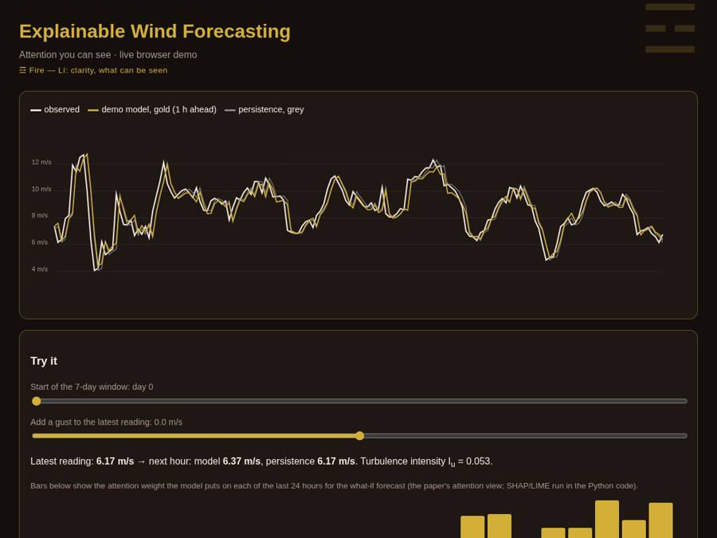

# Explainable wind speed forecasting: SHAP, LIME and attention on a CNN–BiLSTM–Attention model

*風 wind · 明 clarity · 預測 forecast*

[](https://rishabh-bgp.github.io/xai-shap-lime-cnn-bilstm-attention-wind/) [](https://colab.research.google.com/github/Rishabh-bgp/xai-shap-lime-cnn-bilstm-attention-wind/blob/main/notebooks/walkthrough.ipynb) [](https://github.com/Rishabh-bgp/xai-shap-lime-cnn-bilstm-attention-wind/actions/workflows/ci.yml) [](LICENSE)  

[](https://rishabh-bgp.github.io/xai-shap-lime-cnn-bilstm-attention-wind/)

**CNN–BiLSTM–Attention with SHAP and LIME** is the reference implementation of my paper on an **explainable AI (XAI) method for wind speed forecasting**: a Conv1D–BiLSTM network with soft attention forecasts the next hour, and SHAP, LIME and the attention weights are compared to show which past hours drive each forecast. The paper proposes checking whether three different explanation methods (SHAP, LIME and attention) agree on which lags matter, so that grid operators can trust a deep wind forecaster.

**Try it:** [live demo](https://rishabh-bgp.github.io/xai-shap-lime-cnn-bilstm-attention-wind/) · [notebook in Colab](https://colab.research.google.com/github/Rishabh-bgp/xai-shap-lime-cnn-bilstm-attention-wind/blob/main/notebooks/walkthrough.ipynb)

## Live demo

The [live demo](https://rishabh-bgp.github.io/xai-shap-lime-cnn-bilstm-attention-wind/) runs a small version of the model directly in your browser. It shows one week of synthetic wind speed, the model's next-hour forecast (gold) and the persistence forecast (grey). Use the sliders to move through the test period or add a gust to the latest reading, and the forecast updates. The metrics are shown as red seal-style badges.

**About the design.** The look borrows from Chinese ink painting: dark paper, gold lines, crimson seals. Each repository has its own trigram from the I Ching and its own seal stamp. This one uses ☲ 離 Lí, Fire, which stands for light and clarity, the aim of explaining what the model looks at. Across the series, 風 means wind and 預測 means forecast; the trigram for wind itself is ☴ 巽 Xùn. The motifs are decoration only and play no part in the method.

## Architecture · 架構

- **Model:** Conv1D (64 filters, kernel 3) → BiLSTM (64 units per direction) → soft attention over the BiLSTM states → dense head. Input is the 24 most recent hourly wind-speed lags; target is the next hour.
- **SHAP:** expected-gradients SHAP (`shap.GradientExplainer`) with 300 training background samples and 500 test samples; global importance = mean |SHAP| per lag.
- **LIME:** `LimeTabularExplainer` with a ridge surrogate and 1,000 perturbations per explanation (50 explanations by default).
- **Attention:** soft-attention weights averaged over the test samples.
- **Agreement:** Spearman rank correlation between the SHAP, LIME and attention importance rankings, plus the top 3 lags for each.

## Quick start

```bash
python -m venv .venv && source .venv/bin/activate   # Windows: .venv\Scripts\activate
pip install -r requirements.txt
python -m src.train_eval            # full run (default: committed synthetic CSV)
python -m src.train_eval --quick    # CPU smoke test
python -m src.train_eval --csv my_scada.csv
```

Outputs: `results/results.json`: test metrics, persistence baseline, normalized importances, Spearman correlations and top-3 lags..

Run the tests with `pytest -q`. They include a check that the browser demo's JavaScript gives the same predictions as Python (uses `node` if it is installed).

## Notebook for examiners

[](https://colab.research.google.com/github/Rishabh-bgp/xai-shap-lime-cnn-bilstm-attention-wind/blob/main/notebooks/walkthrough.ipynb)

`notebooks/walkthrough.ipynb` is a simplified, step-by-step version of the method, with all its code inside the notebook. It is saved with its outputs, so you can read it without running anything.

To run it yourself:
1. Click **Open in Colab** above (or open the file in Anaconda Jupyter).
2. Choose **Runtime → Run all** (in Jupyter: **Run → Run All Cells**).
3. Wait about a minute on a normal CPU. All the code is inside the notebook, so it runs on its own; it fetches the synthetic CSV from this repository (or regenerates it) if the file is not next to it.
4. Read the printed table: the model's errors next to the *persistence* forecast ("next hour = this hour"). Lower MAE/RMSE and higher R² are better.

## Data · 數據

- **`data/synthetic/synthetic_scada.csv` is synthetic.** It was generated by the seeded script `scripts/make_synthetic.py`
  (seed 0; 120 days hourly: diurnal and seasonal cycles, AR(1) turbulence with gusty spells, plus direction, temperature, pressure, humidity and a logistic power curve). It contains no real measurements and exists so the code runs out of the box.
- The original SCADA data is confidential and is **not** included.
- Everything in `data/` except the synthetic CSV is git-ignored, so you can drop your own CSV there safely.
- To use your own data: pass `--csv path/to/scada.csv` with a `timestamp` and `wind_speed` column (optional: `wind_direction`, `temperature`, `pressure`, `humidity`, `power`; common Kaggle/SCADA aliases such as `Wind Speed (m/s)` are recognized). Data are resampled hourly.
- Regenerate the synthetic file: `python scripts/make_synthetic.py`

## Results vs persistence · 結果

These are the real numbers from this repository on **synthetic** data. They are not the paper's results and cannot be compared with them.
Both models predict the change from the last reading and are compared with persistence, the standard baseline for short-term wind forecasting.

| Model | MAE (m/s) | RMSE (m/s) | R² |
|---|---|---|---|
| Notebook model (1 h ahead) | 0.736 | 1.012 | 0.819 |
| Persistence (1 h ahead) | 0.779 | 1.079 | 0.794 |
| Browser demo model | 0.604 | 0.836 | 0.793 |
| Persistence (demo test period) | 0.656 | 0.886 | 0.767 |

In this short demo the model beats persistence on every row above. The browser demo uses a smaller model (re-implemented in JavaScript); `python scripts/build_demo.py` rebuilds it.

MAE, RMSE (m/s), MAPE (%, computed only where observed wind speed ≥ 0.5 m/s to avoid division by near-zero) and R².

## About this implementation

> **Reference implementation of my paper**, rebuilt in Python on synthetic data because the original SCADA data is confidential. Results will differ from the published numbers, and nothing here claims to reproduce them.

- The paper used DeepSHAP (`DeepExplainer`). Here GradientExplainer (expected gradients) is used instead, because DeepExplainer does not reliably support LSTM layers in current SHAP/PyTorch. Both approximate Shapley values.
- The training set size (7,008 hourly samples in the paper) and the Indian wind-farm data are not reproduced. The deployment pipeline and the CERC deviation-settlement analysis are not implemented.

## Citation · 論文引用

Er. Rishabh Aryan and Manimozhi I (2026). "Explainable AI for Wind Speed Forecasting: SHAP and LIME Interpretability of the CNN–BiLSTM–Attention Model on Real-World Indian Wind Farm Data." *Journal of African Development (JAD)*.

## License

MIT © 2026 Rishabh Aryan. See [LICENSE](LICENSE). The paper itself is not included.

## Other repositories by Rishabh Aryan

- [geoai-hybrid-ga-pso-anfis-wind-forecasting](https://github.com/Rishabh-bgp/geoai-hybrid-ga-pso-anfis-wind-forecasting)
- [wuweidl-daoist-gated-wind-forecasting](https://github.com/Rishabh-bgp/wuweidl-daoist-gated-wind-forecasting)
- [iot-n8n-wind-turbine-predictive-maintenance](https://github.com/Rishabh-bgp/iot-n8n-wind-turbine-predictive-maintenance)
- [multi-agent-turbine-fleet-chief-of-staff](https://github.com/Rishabh-bgp/multi-agent-turbine-fleet-chief-of-staff)
